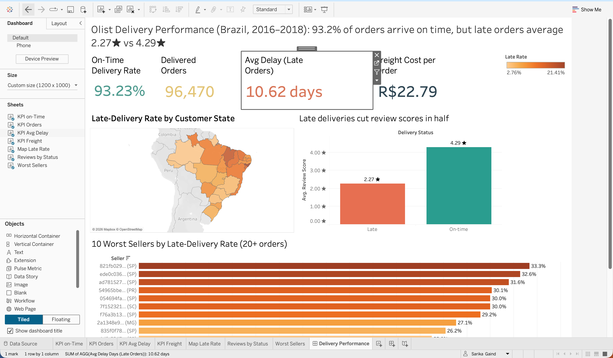
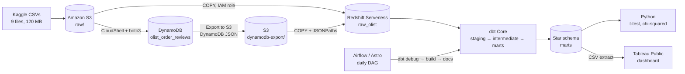
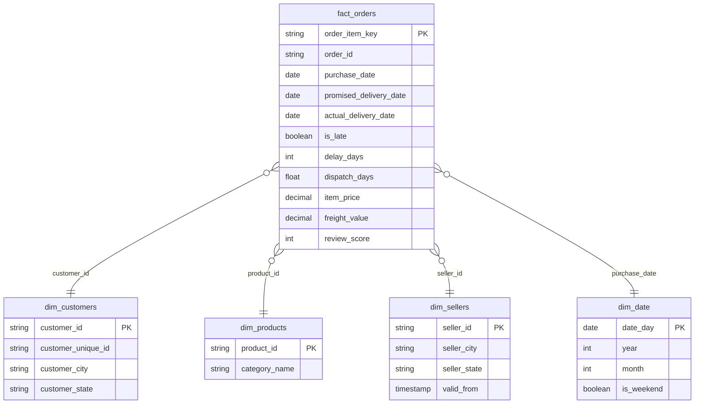
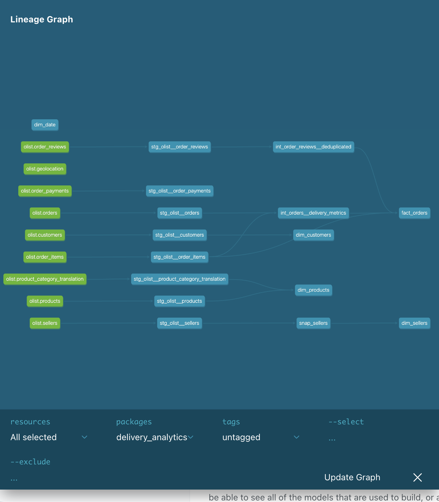

# Delivery Performance Analytics on AWS

End-to-end analytics project on the public [Olist Brazilian E-Commerce dataset](https://www.kaggle.com/datasets/olistbr/brazilian-ecommerce) (CC BY-NC-SA 4.0): raw CSVs land in **Amazon S3**, load into **Amazon Redshift Serverless**, and are modeled with **dbt** into a tested **star schema**. Reviews take a NoSQL round trip through **Amazon DynamoDB**, **Apache Airflow** orchestrates a daily dbt build, **Python** runs the statistical tests, and a **Tableau Public** dashboard presents the results.

**Live dashboard:** [Olist Delivery Performance on Tableau Public](https://public.tableau.com/app/profile/sarika.gaind6780/viz/AWSDeliveryAnalysis/DeliveryPerformance)



## Key findings

All numbers are computed by [`analysis/closeout_metrics.py`](analysis/closeout_metrics.py) and saved in [`results/closeout/`](results/closeout/); scope is 96,470 delivered orders (September 2016 to August 2018).

| Finding | Evidence |
| --- | --- |
| **93.23% of delivered orders arrive on time**; late orders average **10.62 days** late (median 7) | `b2_on_time_and_delay.csv` |
| **Late deliveries cut review scores from 4.29★ to 2.27★**; 62.4% of late orders get 1–2 stars vs 9.3% on time | Welch t-test: t = −100.79, p < 0.001, Cohen's d = −1.71 (`stats_results.csv`) |
| **Slow seller dispatch is the strongest late-delivery signal**: orders handed to the carrier more than 7 days after approval are late 21.39% of the time vs 3.81% within 1 day | `a6_late_by_dispatch_speed.csv` |
| **Cross-state shipping** is late 8.03% vs 4.52% same-state, and accounts for 76.1% of all late orders | `a6_late_by_shipping_route.csv` |
| **Lateness depends on customer state, but only modestly**: worst large-volume state AL is 78.59% on time vs SP 95.51% | Chi-squared: χ² = 1,785.79, df = 26, p < 0.001, Cramér's V = 0.136 |
| **Peak periods break delivery promises**: late rate was 12.40% for November 2017 purchases and 18.96% for March 2018, vs 6.77% overall | `a6_late_by_purchase_month.csv` |
| **Freight averages R$ 22.79 per order** (16.63% of item value) and is highest in the North and Northeast | `b4_freight_overall.csv`, `b4_freight_by_state.csv` |

These are associations, not proven causes; see the full case study for caveats.

## Architecture



| Layer | Technology | Notes |
| --- | --- | --- |
| Storage | Amazon S3 | Private bucket, SSE-S3, Block Public Access on |
| Warehouse | Redshift Serverless | 4 RPU base and max, 8 RPU-hour daily usage limit |
| NoSQL | DynamoDB | On-demand table, export to S3 via point-in-time recovery |
| Transformation | dbt Core 1.12 + dbt-redshift | 16 models, 1 snapshot, 90 tests |
| Orchestration | Apache Airflow 3 (Astro CLI) | `delivery_analytics_dbt_daily`, `@daily` |
| Statistics | Python (pandas, SciPy) | Welch t-test, chi-squared with Cramér's V |
| Dashboard | Tableau Public | Click a state to filter every chart |

## Star schema

`fact_orders` is at **order-item grain** (112,650 rows, 98,666 orders). Order-level fields (delivery dates, late flag, review score) repeat on each item, so order-level KPIs use `count(distinct order_id)` or `is_first_item_in_order`.



`dim_sellers` reads the current row of `snap_sellers`, an **SCD Type 2** snapshot that keeps a seller's full location history ([demo](results/scd2_seller_history.png)).

## dbt lineage



- **Staging (9 views):** rename and cast the all-text raw layer; zip prefixes kept as text to preserve leading zeros.
- **Intermediate (2 views):** `int_orders__delivery_metrics` is the single definition of on-time, delay and dispatch; `int_order_reviews__deduplicated` keeps one review per order from the DynamoDB copy.
- **Marts (5 tables):** the star schema above.
- **Tests (90):** unique, not_null, relationships, accepted_values (including Brazil's 27 state codes), and a singular test that fails if the DynamoDB reviews ever drift from the CSV.

## Definitions

| Term | Definition |
| --- | --- |
| Scope | `order_status = 'delivered'` with a customer delivery date |
| On-time | Delivered **date** ≤ estimated delivery **date** (dates, not timestamps) |
| Delay | Delivered date − estimated date, for late orders |
| Dispatch days | Order approval → carrier handoff |
| Freight % | `SUM(freight_value) / SUM(price)` |

## Repository layout

```
sql/                 Raw table DDL, COPY scripts, SCD2 demo, DynamoDB export load
scripts/             DynamoDB loader (run in AWS CloudShell)
config/              JSONPaths file for the DynamoDB export COPY
delivery_analytics/  dbt project (models, snapshot, tests, macros)
airflow/             Astro project: Dockerfile, daily DAG, container dbt profile
analysis/            Statistics, Tableau extract and closeout scripts
results/             Saved outputs and screenshots behind every reported number
```

## Reproduce it

1. Download the Olist CSVs from Kaggle and upload them to `s3://<bucket>/raw/`.
2. Create a Redshift Serverless workgroup with a default IAM role that can read the bucket, then run `sql/01_create_raw_tables.sql` and `sql/02_copy_raw_tables.sql`.
3. Load reviews into DynamoDB with `scripts/load_reviews_to_dynamodb.py`, export the table to S3, and run `sql/04_load_dynamodb_export.sql`.
4. Create a Python 3.12 virtual environment, `pip install -r requirements.txt`, add a `~/.dbt/profiles.yml` whose password reads `DBT_REDSHIFT_PASSWORD`, then run `dbt build` in `delivery_analytics/`.
5. Optional: `cd airflow && astro dev start` with `DBT_REDSHIFT_PASSWORD` in `airflow/.env`.
6. Run `python analysis/delivery_stats.py`, `analysis/export_dashboard_data.py` and `analysis/closeout_metrics.py`.

## Cost and guardrails

Built for **$0**: AWS sign-up credits, the Redshift Serverless free-trial credit and DynamoDB's free storage. Guardrails: a $20 account spend limit, $1 and $5 budget alerts, Redshift capped at 4 RPUs with an 8 RPU-hour daily limit, and a single-IP security group rule. Total cost reported by Cost Explorer on 2026-11-17: **$0.00**, with $299.29 of the $300 Redshift trial credit unused.

## Notes and path to production

- **QuickSight** was the planned dashboard tool, but the AWS account type used here reports "Access to this service is not supported" for QuickSight and Amazon Quick, so Tableau Public was used.
- **Production orchestration:** the same DAG would run on **Amazon MWAA** (managed Airflow) or on Airflow's Helm chart on **Amazon EKS (Kubernetes)**, with credentials in AWS Secrets Manager instead of an `.env` file.
- **Data gaps:** the Olist data has no carrier field, so carrier performance can't be separated from seller dispatch.
